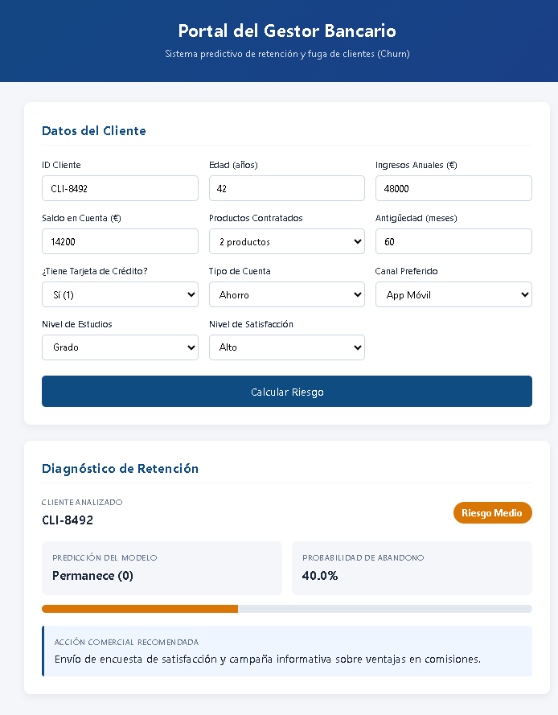

# Despliegue de la Aplicación en la Nube

Este documento describe el acceso, arquitectura de inferencia e instrucciones de uso para la API de Predicción de Abandono de Clientes, desplegada en la nube mediante Modal con FastAPI y Scikit-Learn (`ColumnTransformer` + `KNeighborsClassifier`).

## 1. URL Pública de la Aplicación

La aplicación se encuentra activa y accesible de forma pública a través del siguiente enlace (alojada en *Modal*):

[**URL:**](https://alex-cisnerosap--prediccion-de-permanecia-clientes-fastapi-app.us-east.modal.run)`https://alex-cisnerosap--prediccion-de-permanecia-clientes-fastapi-app.us-east.modal.run`

**Nota sobre tiempos de carga:**  Segun accedas a la url deberas esperar un breve tiempo para que funcione correctamente

## 2. Instrucciones Breves de Uso

El sistema permite evaluar el riesgo de fuga de clientes bancarios tanto desde su interfaz gráfica para gestores como directamente a través de su API REST.

### A. Probar la Interfaz Web (`/`)

1. Abre tu navegador y accede a la ruta raíz de la aplicación: [Ruta raiz:](https://alex-cisnerosap--prediccion-de-permanecia-clientes-fastapi-app.us-east.modal.run)
   `https://alex-cisnerosap--prediccion-de-permanecia-clientes-fastapi-app.us-east.modal.run/`
2. Visualizarás el formulario web interactivo del gestor bancario (`templates/index.html`).
3. Rellena los datos del cliente respetando los valores admitidos:
   * **Identificador (`id_cliente`):** Texto entre 1 y 30 caracteres (ej. `CLI-1042`).
   * **Edad (`edad`):** Entero entre `1` y `120`.
   * **Ingresos anuales (`ingresos_anuales`):** Valor numérico mayor a `0`.
   * **Saldo en cuenta (`saldo_cuenta`):** Valor numérico mayor o igual a `0`.
   * **Número de productos (`num_productos`):** Entero entre `1` y `4`.
   * **Antigüedad en meses (`antiguedad_meses`):** Entero mayor o igual a `0`.
   * **¿Tiene tarjeta? (`tiene_tarjeta`):** `0` (No) o `1` (Sí).
   * **Tipo de cuenta (`tipo_cuenta`):** `Corriente`, `Ahorro`, `Nomina` o `Inversion`.
   * **Canal preferido (`canal_preferido`):** `App Movil`, `Cajero Antiguo`, `Oficina`, `Telefono` o `Web`.
   * **Nivel de estudios (`nivel_estudios`):** `Primaria`, `Secundaria`, `Grado`, `Master` o `Doctorado`.
   * **Nivel de satisfacción (`nivel_satisfaccion`):** `Muy Bajo`, `Bajo`, `Medio`, `Alto` o `Muy Alto`.
4. Haz clic en el botón de envío para ejecutar la inferencia.
5. La interfaz mostrará el diagnóstico del cliente: si abandona o no, la probabilidad exacta, el nivel de riesgo (**Bajo**, **Medio** o **Alto**) y la acción comercial recomendada.

### B. Probar la Documentación Interactiva (`/docs`)

La API expone una interfaz **Swagger UI** autogenerada por FastAPI para realizar pruebas directas contra el endpoint de inferencia:

1. Accede a la ruta `/docs`: [Ruta docs:](https://alex-cisnerosap--prediccion-de-permanecia-clientes-fastapi-app.us-east.modal.run/docs)
   `https://alex-cisnerosap--prediccion-de-permanecia-clientes-fastapi-app.us-east.modal.run/docs`
2. Despliega el endpoint **`POST /predict`** (sección *Inferencia*) y haz clic en **"Try it out"**.
3. Introduce un JSON válido en el campo `Request body` siguiendo el esquema `ClienteInput`. Puedes utilizar este ejemplo listo para probar:

   ```json
   {
     "id_cliente": "CLI-98765",
     "edad": 42,
     "ingresos_anuales": 38500.50,
     "saldo_cuenta": 12400.00,
     "num_productos": 2,
     "antiguedad_meses": 36,
     "tiene_tarjeta": 1,
     "tipo_cuenta": "Nomina",
     "canal_preferido": "App Movil",
     "nivel_estudios": "Grado",
     "nivel_satisfaccion": "Medio"
   }
   ```

4. Pulsa **"Execute"** y comprueba que el servidor devuelve el código `200 OK` con una estructura de respuesta (`PrediccionOutput`) similar a esta:

   ```json
   {
     "id_cliente": "CLI-98765",
     "abandono": 0,
     "probabilidad_abandono": 0.4,
     "nivel_riesgo": "Medio",
     "accion_recomendada": "Envío de encuesta de satisfacción y campaña informativa sobre ventajas en comisiones."
   }
   ```

---

## 📸 3. Evidencia de Funcionamiento en Producción

A continuación se muestra una captura de pantalla de la interfaz web en producción ejecutando una inferencia real sobre un perfil de cliente:

